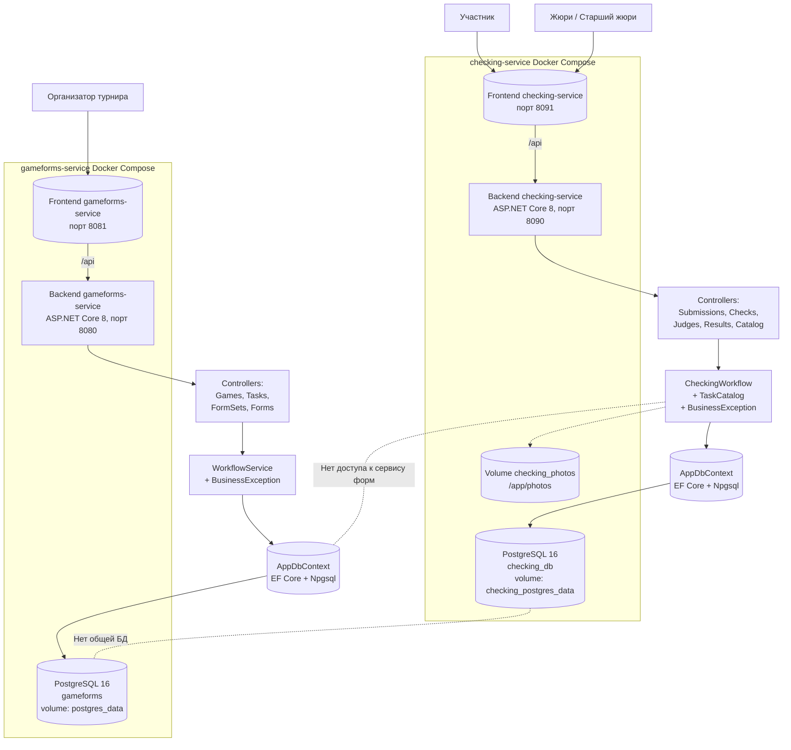

# Обзор архитектуры проекта
**Стек технологий:** .NET 8 (ASP.NET Core Web API), Entity Framework Core 8, PostgreSQL 16, Npgsql, Swagger/OpenAPI (Swashbuckle), SkiaSharp (валидация изображений), Docker & Docker Compose, Nginx, HTML/CSS/JavaScript (статический frontend)
**Общее назначение проекта:** Учебный микросервисный проект по проведению командного турнира. Состоит из двух независимых микросервисов: `gameforms-service` ("Листок") для подготовки игр, задач и печатных форм, и `checking-service` ("Вердикт") для приёма решений участников, проверки фото работ и судейской проверки с выставлением результатов. Каждый сервис имеет собственную базу PostgreSQL, свой frontend и разворачивается через отдельный Docker Compose. Общей базы, брокера сообщений и авторизации нет.

## Функциональные группы

### 1. Микросервис "Листок" (gameforms-service) — Подготовка форм и задач
* **Назначение:** Отвечает за жизненный цикл игровых материалов: создание игр и задач, формирование комплектов форм для команд, переходы статусов (черновик → опубликовано → подготовлено → напечатано → выдано) и выдача наборов командам. Сервис не содержит модуля авторизации и не знает о командах, кроме списка `TeamId` при генерации комплектов.
* **Структура (где лежит):**
  * `gameforms-service/docker-compose.yml` — PostgreSQL, backend, frontend, один именованный volume `postgres_data`
  * `gameforms-service/GameFormsService/Program.cs` — точка входа: DI, DbContext, Swagger, обработка ошибок, применение миграций при старте, health-check
  * `gameforms-service/GameFormsService/GameFormsService.csproj` — зависимости: EF Core, Npgsql, Swagger
  * `gameforms-service/GameFormsService/Controllers/` — `GamesController`, `TasksController`, `FormSetsController`, `FormsController`
  * `gameforms-service/GameFormsService/Services/WorkflowService.cs` — бизнес-логика и проверки переходов статусов (сущность `BusinessException`)
  * `gameforms-service/GameFormsService/Data/AppDbContext.cs` — контекст EF Core с сущностями `Game`, `GameTask`, `FormSet`, `Form`, связи и уникальные индексы
  * `gameforms-service/GameFormsService/Models/Entities.cs` — модели домена и перечисления статусов (`GameStatus`, `TaskStatus`, `FormSetStatus`, `FormStatus`)
  * `gameforms-service/GameFormsService/Models/Requests.cs` — DTO для входящих запросов с атрибутами валидации
  * `gameforms-service/GameFormsService/Data/Migrations/` — начальная миграция и снимок модели
  * `gameforms-service/frontend/` — статический интерфейс (index.html, styles.css, app.js, nginx.conf, Dockerfile)
* **Как работает код (вкратце):** При старте `Program.cs` настраивает DI, подключает `AppDbContext` к PostgreSQL через `Npgsql`, регистрирует `WorkflowService` как scoped, подключает контроллеры и Swagger, а затем применяет pending-миграции через `Database.MigrateAsync()`. Контроллеры принимают HTTP-запросы, валидируют входные DTO и delegates бизнес-логику в `WorkflowService`. Сервис инкапсулирует правила: например, опубликованную игру нельзя редактировать, задачу можно снять с публикации только если она не назначена форме, выдачу набора можно сделать один раз и только после печати. Конфликты и нарушения правил порождают `BusinessException`, который в middleware преобразуется в JSON-ответ `{ "error": "..." }` с HTTP 400/404/409. Все сущности имеют строковое представление enum в БД (`HasConversion<string>`).

### 2. Микросервис "Вердикт" (checking-service) — Приём решений и судейская проверка
* **Назначение:** Отвечает приёме решений участников (submissions), загрузке и валидации фото работ, создании проверочных задач (check requests), назначении их членам жюри (judges), эскалации старшему жюри и фиксации итоговых результатов. Сервер содержит встроенный демонстрационный каталог форм (`TaskCatalog`), так как нет доступа к внешнему сервису подготовки форм и нет OCR.
* **Структура (где лежит):**
  * `checking-service/docker-compose.yml` — PostgreSQL, backend, frontend, два именованных volume (`checking_postgres_data`, `checking_photos`)
  * `checking-service/CheckingService/Program.cs` — точка входа: DI, DbContext, `CheckingWorkflow`, Swagger, глобальная обработка исключений, health-check, применение миграций при старте
  * `checking-service/CheckingService/CheckingService.csproj` — зависимости: EF Core, Npgsql, Swagger, **SkiaSharp** (для декодирования JPEG/PNG)
  * `checking-service/CheckingService/Controllers/` — `SubmissionsController`, `ChecksController`, `JudgesController`, `ResultsController` (+ `CatalogController` для публичного демо-каталога)
  * `checking-service/CheckingService/Services/CheckingWorkflow.cs` — бизнес-процесс проверки, каталог демонстрационных форм (`TaskCatalog`), класс `BusinessException`
  * `checking-service/CheckingService/Data/AppDbContext.cs` — контекст EF Core с сущностями `Submission`, `CheckRequest`, `Judge`, `CheckResult`, связи и частичный уникальный индекс на занятость жюри
  * `checking-service/CheckingService/Models/Entities.cs` — модели `Submission`, `CheckRequest`, `Judge`, `CheckResult` и enum (`SubmissionStatus`, `CheckStatus`, `JudgeRole`)
  * `checking-service/CheckingService/Models/Requests.cs` — DTO для входящих запросов с валидацией
  * `checking-service/CheckingService/Data/Migrations/` — начальная миграция и снимок модели
  * `checking-service/frontend/` — статический интерфейс (index.html, styles.css, app.js, nginx.conf, Dockerfile)
* **Как работает код (вкратце):** `Program.cs` analogous к gameforms-service, но дополнительно обрабатывает `PostgresException` с SQLState `40001` (сериализуемость) и `23505` (уникальное ограничение) как HTTP 409. Контроллеры принимают запросы (включая `multipart/form-data` для загрузки фото), валидируют DTO и вызывают методы `CheckingWorkflow`. Сервис проверяет комбинацию `(GameId, FormId, TaskId)` против `TaskCatalog`, при загрузке фото декодирует изображение через SkiaSharp (отклоняет не-JPEG/PNG и битые файлы), управляет статусами решения и проверки, назначает свободному жюри, обрабатывает отказ (decline) с автоматическим переводом в `Escalated` и попыткой назначения старшего жюри, фиксирует результат в рамках транзакции `Serializable`. Частичный уникальный индекс в PostgreSQL гарантирует, что у одного члена жюри не более одной активной проверки.

### 3. API / Routing (Контроллеры и маршрутизация)
* **Назначение:** Обеспечивают REST API-интерфейс обоих микросервисов, принимают HTTP-запросы, выполняют привязку и валидацию моделей, возвращают JSON-ответы.
* **Структура (где лежит):**
  * `checking-service/CheckingService/Controllers/` — `SubmissionsController` (`/api/submissions`), `ChecksController` (`/api/checks`), `JudgesController` (`/api/judges`), `ResultsController` (`/api/results`), `CatalogController` (`/api/catalog/forms`)
  * `gameforms-service/GameFormsService/Controllers/` — `GamesController` (`/api/games`), `TasksController` (`/api/tasks`), `FormSetsController` (`/api/formsets`), `FormsController` (`/api/forms`)
* **Как работает код (вкратце):** Все контроллеры наследуют от `ControllerBase`, помечены `[ApiController]` и имеют атрибут `[Route("api/...")]`. Они используют инъекцию зависимостей в конструкторе (`AppDbContext` и соответствующий сервис workflow). Методы_actions асинхронны (`async Task<IActionResult>`), возвращают стандартные результаты ASP.NET Core (`Ok`, `CreatedAtAction`, `NotFound`, `StatusCode`). JSON-сериализация enum настроена через `JsonStringEnumConverter`, поэтому статусы передаются как строки. В `checking-service` additionally есть поддержка загрузки файлов через `IFormFile` с лимитом 9 МБ. Swagger/OpenAPI генерируется автоматически и доступен по `/swagger`.

### 4. Бизнес-логика / Workflow (Сервисы бизнес-процессов)
* **Назначение:** Инкапсулируют все бизнес-правила, валидации, переходы состояний и orchestration операций с базой данных. Это "толстый" слой бизнес-логики между контроллерами и EF Core.
* **Структура (где лежит):**
  * `checking-service/CheckingService/Services/CheckingWorkflow.cs` — класс `CheckingWorkflow`, статический класс `TaskCatalog` ( демо-каталог с 3 задачами), класс `BusinessException`
  * `gameforms-service/GameFormsService/Services/WorkflowService.cs` — класс `WorkflowService`, класс `BusinessException`
* **Как работает код (вкратце):** Каждый метод сервиса принимает входные параметры, выполняет валидацию (существование сущности, допустимость перехода статуса, права доступа), вносит изменения в `DbContext` и сохраняет через `SaveChangesAsync()`. Критические операции (отказ жюри, эскалация, завершение проверки, выдача набора) оборачиваются в транзакцию `IsolationLevel.Serializable` для предотвращения race condition. При нарушении бизнес-правил выбрасывается `BusinessException` с кодом HTTP и сообщением, которое middleware в `Program.cs` преобразует в JSON-ответ. `CheckingWorkflow` дополнительно содержит статические методы `SubmissionView` и `JudgeView` для формирования ответов API без раскрытия `TeamId` жюри, и `TaskCatalog` с вшитыми задачами (столица Франции, 7×8, символ воды).

### 5. Работа с базой данных (Data Access / EF Core)
* **Назначение:** Обеспечивают ORM-доступ к PostgreSQL, определяют схему данных, связи между сущностями и индексы, применяют миграции при запуске.
* **Структура (где лежит):**
  * `checking-service/CheckingService/Data/AppDbContext.cs` + `Migrations/`
  * `gameforms-service/GameFormsService/Data/AppDbContext.cs` + `Migrations/`
* **Как работает код (вкратце):** `AppDbContext` наследуется от `Microsoft.EntityFrameworkCore.DbContext` и настраивается через `UseNpgsql` с connection string из конфигурации. В `OnModelCreating` настраиваются: строковое представление enum (`HasConversion<string>`), внешние ключи с `DeleteBehavior.Restrict` (предотвращают каскадное удаление), уникальные индексы (например, `FormSet.GameId + TeamId`, `Form.FormSetId + TaskId`, `CheckRequest.SubmissionId`, `CheckResult.CheckRequestId`) и частичный уникальный индекс на занятых судей. Миграции применяются автоматически при старте приложения через `Database.MigrateAsync()` перед `app.Run()`, поэтому в Docker-окружении не требуется ручное применение миграций. Каждый сервис использует свою отдельную базу (`checking_db` и `gameforms`).

### 6. Модели данных (Domain Models и DTO)
* **Назначение:** Описывают структуру сущностей домена и контракты входящих/выходящих данных API.
* **Структура (где лежит):**
  * `checking-service/CheckingService/Models/Entities.cs` — `Submission`, `CheckRequest`, `Judge`, `CheckResult` + enum
  * `checking-service/CheckingService/Models/Requests.cs` — `SubmitRequest`, `UploadPhotoRequest`, `ValidatePhotoRequest`, `ResubmitRequest`, `CreateCheckRequest`, `AssignRequest`, `JudgeActionRequest`, `CompleteRequest`, `CreateJudgeRequest`
  * `gameforms-service/GameFormsService/Models/Entities.cs` — `Game`, `GameTask`, `FormSet`, `Form` + enum
  * `gameforms-service/GameFormsService/Models/Requests.cs` — `CreateGameRequest`, `TextRequest`, `CreateTaskRequest`, `EditTaskRequest`, `GenerateFormSetsRequest`, `CreateFormRequest`
* **Как работает код (вкратце):** Сущности (`Entities.cs`) используют атрибуты `System.ComponentModel.DataAnnotations` (`MaxLength`, `Required`, `Range`) и являются полноценными EF Core entity types с навигационными свойствами. DTO (`Requests.cs`) реализованы как C# `record` (неизменяемые) с атрибутами валидации; ASP.NET Core автоматически валидирует их при привязке к действиям контроллера и возвращает HTTP 400 с `ValidationProblemDetails` при ошибках. Ответы API формируются либо анонимными объектами в сервисах (`SubmissionView`, `JudgeView`), либо проекциями LINQ в контроллерах.

### 7. Фронтенд (Пользовательский интерфейс)
* **Назначение:** Статические веб-интерфейсы для интерактивного взаимодействия с обоими микросервисами через браузер. Обслуживаются Nginx и проксируют API-запросы на бэкенд.
* **Структура (где лежит):**
  * `checking-service/frontend/` — `index.html`, `styles.css`, `app.js`, `nginx.conf`, `Dockerfile` (порт 8091)
  * `gameforms-service/frontend/` — `index.html`, `styles.css`, `app.js`, `nginx.conf`, `Dockerfile` (порт 8081)
* **Как работает код (вкратце):** Каждый frontend представляет собой статические HTML/CSS/JS файлы, упакованные в отдельный Docker-образ на основе Nginx. `nginx.conf` настраивает проксирование запросов с пути `/api` (и `/swagger` для gameforms) на соответствующий бэкенд-контейнер. Фронтенды не имеют собственной логики авторизации — это простые демонстрационные интерфейсы для ручного прохождения сценариев. В `checking-service` frontend позволяет подать решение, загрузить фото, пройти проверку жюри; в `gameforms-service` — создавать игры, задачи, генерировать комплекты форм, готовить, печатать и выдавать их командам.

### 8. Инфраструктура и развёртывание (DevOps / Docker)
* **Назначение:** Обеспечивают контейнеризацию, оркестрацию через Docker Compose, управление сетями, volume и переменными окружения для независимого развёртывания каждого микросервиса.
* **Структура (где лежит):**
  * `checking-service/docker-compose.yml` + `CheckingService/Dockerfile` + `frontend/Dockerfile` + `.dockerignore`
  * `gameforms-service/docker-compose.yml` + `GameFormsService/Dockerfile` + `frontend/Dockerfile` + `.dockerignore`
* **Как работает код (вкратце):** Каждый сервис разворачивается независимо через свой `docker-compose.yml`. В compose-стеке три сервиса: `db` (PostgreSQL 16 Alpine с healthcheck `pg_isready`), `backend` (ASP.NET Core приложение, собирается из соответствующего Dockerfile) и `frontend` (Nginx со статическими файлами). Backend зависит от healthy-состояния БД (`condition: service_healthy`), frontend зависит от старта backend. Данные БД и фотографии (`/app/photos`) хранятся в именованных Docker volume, что сохраняет данные между перезапусками (`docker compose down` без `-v`). Порты: checking-service — backend 8090, frontend 8091; gameforms-service — backend 8080, frontend 8081. PostgreSQL не пробрасывается наружу, доступен только внутри Docker-сети по имени хоста `db`. Сборка и запуск: `docker compose up --build` из папки соответствующего сервиса.

## Взаимодействие модулей

Ниже описана типичная цепочка обработки запроса от получения HTTP-запроса до сохранения в БД, а также схема взаимодействия функциональных групп.

### Пример сквозного сценария: приём решения участника и проверка жюри (checking-service)

```
Участник (Frontend, браузер)
      │
      ▼
[HTTP POST /api/submissions] ──► SubmissionsController
      │                              │
      ▼                              ▼
  YourRequest DTO              CheckingWorkflow.Submit()
      │                              │
      ▼                              ▼
  Валидация (ModelState)      Проверка TaskCatalog (GameId, FormId, TaskId)
      │                              │
      ▼                              ▼
  400 при ошибке              AppDbContext.Submissions.Add() → SaveChangesAsync()
      │                              │
      ▼                              ▼
  JSON {submission} ◄─────────────────────────────────────┘
```

```
Жюри (Frontend)
      │
      ▼
[GET /api/checks/queue] ──► ChecksController.Queue()
      │                              │
      ▼                              ▼
  Фильтрация статусов        Возврат JudgeView (без TeamId)
  (Queued / Escalated без JudgeId)
      │
      ▼
[POST /api/checks/{id}/accept] ──► ChecksController.Accept()
      │                              │
      ▼                              ▼
  CheckingWorkflow.Accept(id, judgeId)  Проверка владения и статуса Assigned/Escalated
      │                              │
      ▼                              ▼
  Статус → Accepted                SaveChangesAsync()
      │
      ▼
[POST /api/checks/{id}/complete] ──► ChecksController.Complete()
      │                              │
      ▼                              ▼
  CheckingWorkflow.Complete()      Транзакция Serializable:
                                     - Проверка отсутствия существующего CheckResult
                                     - Создание CheckResult
                                     - Статус CheckRequest → Completed
                                     - Статус Submission → Completed
                                     - Вызов Dispatch() (освобождение жюри / новая проверка)
```

### Схема взаимодействия функциональных групп (Mermaid)



### Ключевые особенности взаимодействия

1. **Ниже уровень зависимости между сервисами:** `checking-service` не вызывает `gameforms-service` по HTTP и не имеет доступа к его базе. Вместо этого используется вшитый серверный `TaskCatalog` с демонстрационными задачами. Это учебное упрощение — в реальной системе каталог следовало бы заменить на защищённый API сервиса форм.
2. **Нет сквозной авторизации:** ни один из сервисов не реализует аутентификацию или авторизацию. Роли (`Judge`, `SeniorJudge`) передаются в теле запросов и доверяются на уровне приложения.
3. **Каждый сервис автономен:** собственная БД, собственное compose-окружение, свои миграции, свой frontend. Может развёртываться и масштабироваться независимо.
4. **Транзакционность:** критические изменения в `CheckingWorkflow` и `WorkflowService` выполняются в транзакциях `Serializable` для защиты от гонок данных (например, двойная выдача одного набора форм или две активные проверки у одного судьи).
5. **Обработка ошибок:** бизнес-исключения `BusinessException` перехватываются глобальной middleware в `Program.cs` и возвращаются клиенту как JSON `{ "error": "..." }` с соответствующим HTTP-кодом (400/404/409). Конфликты параллелизма PostgreSQL (`40001`, `23505`) также обрабатываются как 409.